<p align="center">
  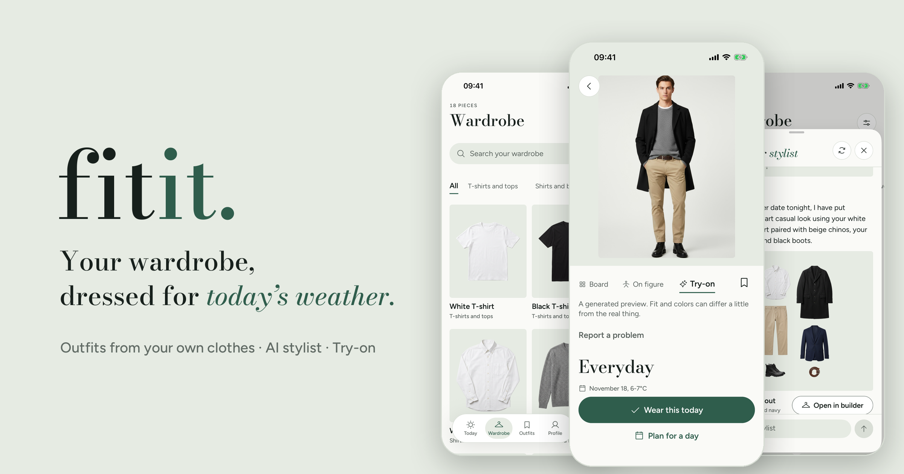
</p>

<p align="center">
  <b>Ubiera cię z tego, co już wisi w twojej szafie.</b><br>
  Sprawdza pogodę, składa trzy stroje na dziś i pokazuje je na sylwetce podobnej do twojej.
</p>

<br>

<p align="center">
  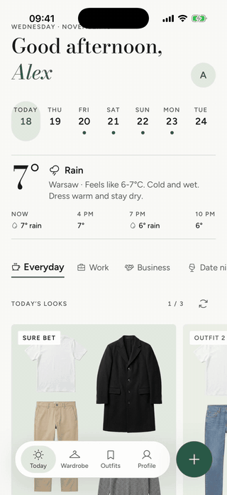
</p>

---

## Dzień zaczyna się od pogody

Otwierasz aplikację i wiesz, jak jest za oknem: temperatura odczuwalna, deszcz, prognoza na resztę dnia. Pod spodem czekają trzy stroje z twoich ubrań, dobrane do tej pogody i do okazji, którą wybierasz jednym stuknięciem: zwykły dzień, praca, spotkanie biznesowe, randka, wyjście ze znajomymi albo trening. Pierwszy to pewniak z rzeczy, które lubisz. Drugi wyciąga z szafy coś, po co dawno nie sięgałeś. Trzeci łączy rzeczy, których jeszcze razem nie nosiłeś.

<p align="center">
  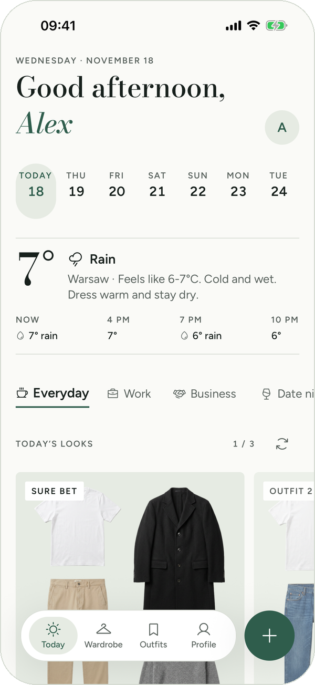
  &nbsp;&nbsp;
  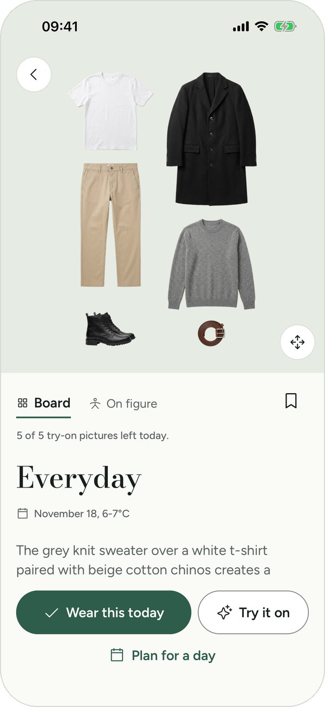
</p>

## Zobacz strój na sobie, zanim go włożysz

Każdy strój ma trzy widoki. **Board** to ubrania rozłożone obok siebie, możesz je przesuwać palcem. **On figure** zakłada je na manekina o twojej sylwetce: kurtka wisi z boku, a sweter i koszulka pod spodem dzielą się sylwetką pół na pół. **Try-on** zamawia zdjęcie, na którym model ma na sobie dokładnie twoje rzeczy.

<p align="center">
  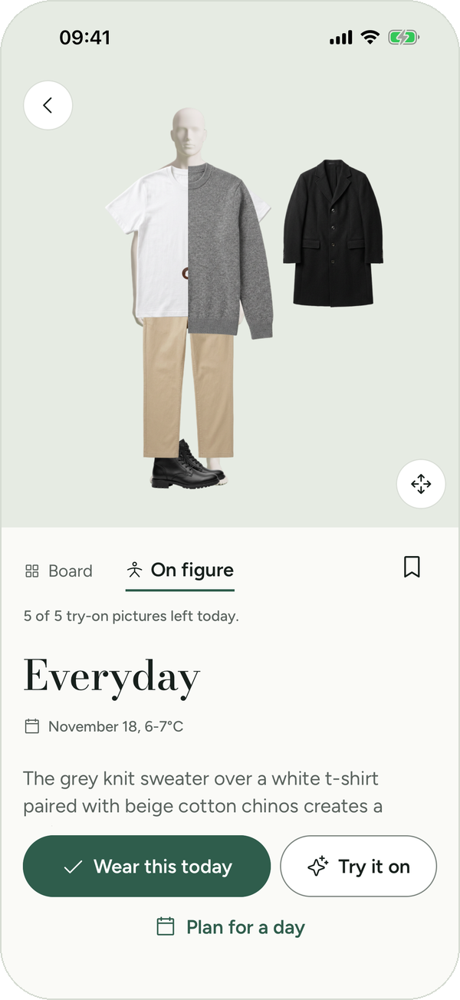
  &nbsp;&nbsp;
  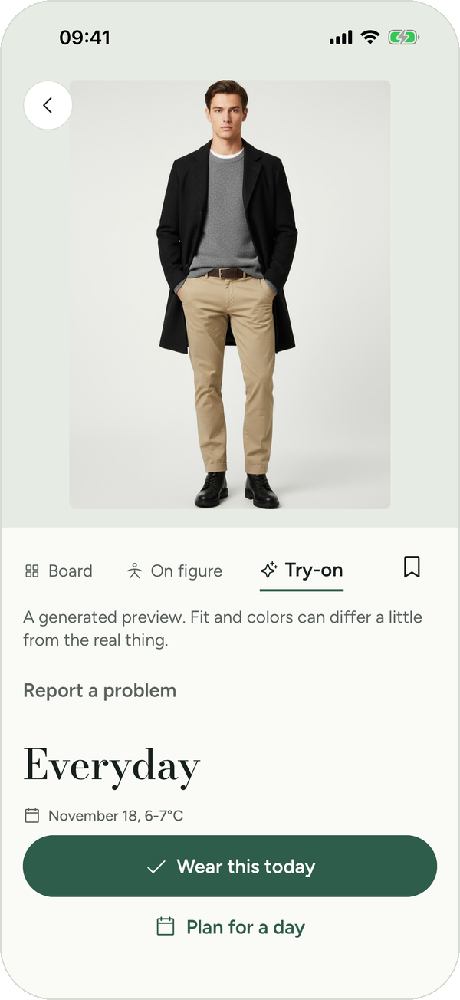
</p>

## Stylista, który zna twoją szafę

Możesz po prostu zapytać. Co na wieczór, czego brakuje w szafie, co warto kupić jako następne. Stylista widzi twoje ubrania, style i dzisiejszą pogodę, więc proponuje strój złożony z twoich rzeczy. Gotowy strój otwierasz jednym przyciskiem w builderze. Zdjęć nie dostaje, tylko opisy ubrań. Odpowiada w języku, w którym piszesz.

<p align="center">
  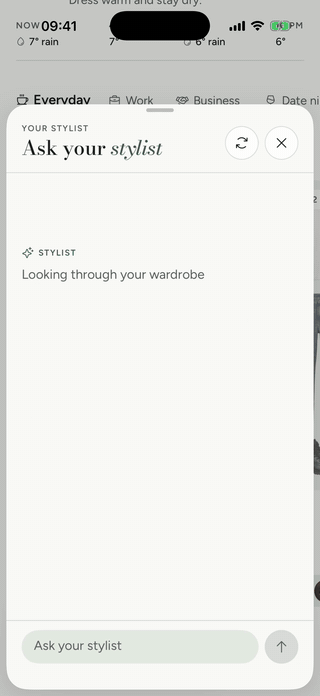
  &nbsp;&nbsp;
  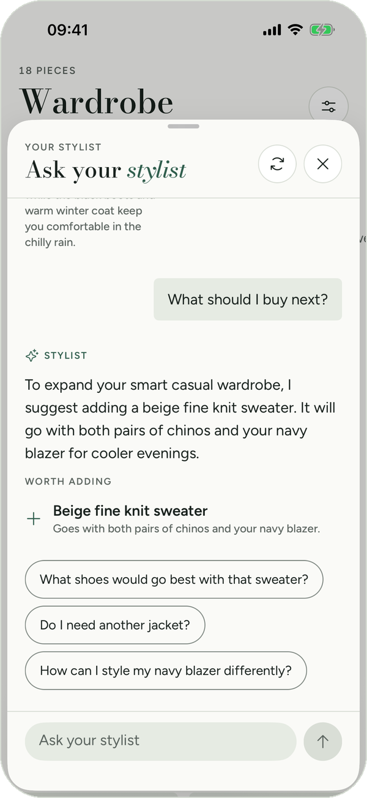
</p>

## Szafa

Robisz zdjęcie ubrania, a aplikacja wycina je z tła, rozpoznaje rodzaj, kolor oraz styl i odkłada je na właściwą półkę. Na start możesz też dorzucić podstawy z gotowego katalogu (biały T-shirt, jeansy, trampki) i jeszcze tego samego dnia dostać pierwsze propozycje. W builderze składasz strój sam: wybierasz rzeczy z szafy, podmieniasz pojedyncze sztuki, a board zmienia się razem z wyborem.

<p align="center">
  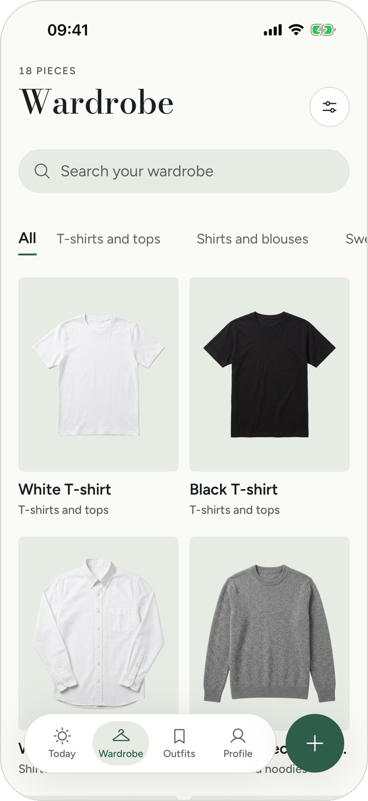
  &nbsp;&nbsp;
  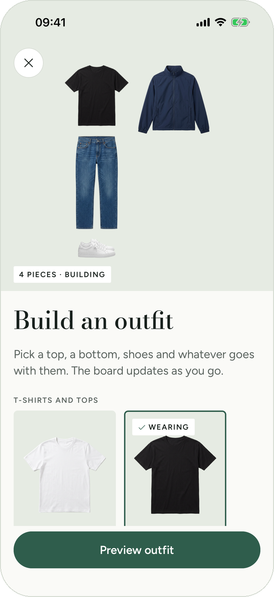
</p>

## Zaplanuj tydzień

Strój, który ci się podoba, zapisujesz zakładką albo przypinasz do konkretnego dnia. W kalendarzu widać, co masz zaplanowane, a co już nosiłeś. Rano nie trzeba nic wymyślać.

<p align="center">
  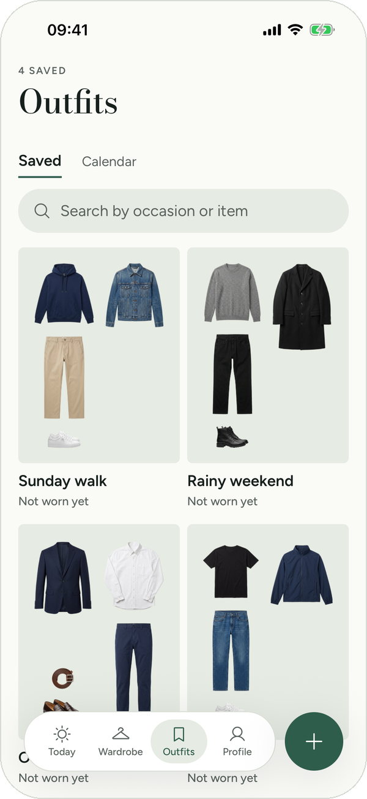
  &nbsp;&nbsp;
  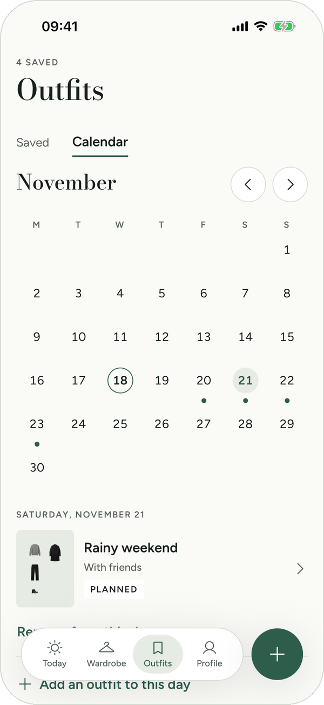
</p>

## Twoje kolory

Jedno selfie w świetle dziennym (zdjęcie znika zaraz po analizie) albo cztery krótkie pytania o skórę, włosy i oczy. Wychodzi z tego twój typ kolorystyczny i paleta: w czym ci najlepiej, a czego lepiej unikać. Stylista bierze ją pod uwagę przy każdym stroju.

<p align="center">
  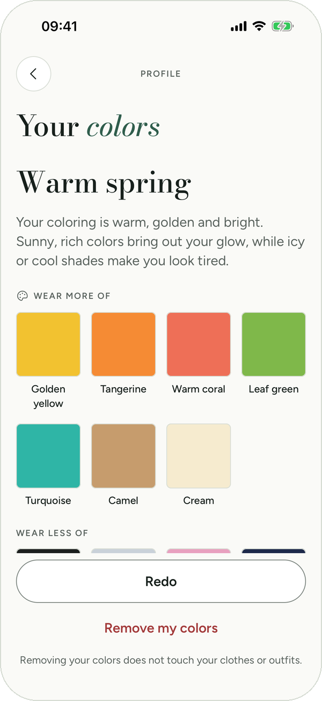
</p>

---

## Pod maską

| | |
| --- | --- |
| Aplikacja | Expo SDK 58, React Native, TypeScript, Expo Router |
| Serwer | .NET 10 (Minimal API), PostgreSQL, Hangfire |
| AI | Gemini (opisy ubrań, stylista, kolory), fal.ai (wycinanie z tła, przymierzalnia) |
| Zdjęcia | Cloudflare R2 |
| Strona | React + Vite (`landing/`) |

Uruchomienie lokalne:

```bash
cp .env.example .env
docker compose up -d db storage
```

```bash
cd backend && dotnet run --project src/FitIt.Api --launch-profile http
```

```bash
cd mobile && npm install && npx expo start
```

Klucze do Gemini i fal.ai trzyma się w .NET user secrets, nigdy w repozytorium. Bez nich API odpowiada zastępczymi danymi, więc aplikację da się uruchomić i przeklikać bez żadnych kont. Więcej w [`docs/dostawcy.md`](docs/dostawcy.md), a specyfikacja jest w [`docs/FitIt_Specyfikacja_MVP.md`](docs/FitIt_Specyfikacja_MVP.md).

<p align="center"><sub>fitit. · projekt dyplomowy · Mikołaj Skaziak</sub></p>
